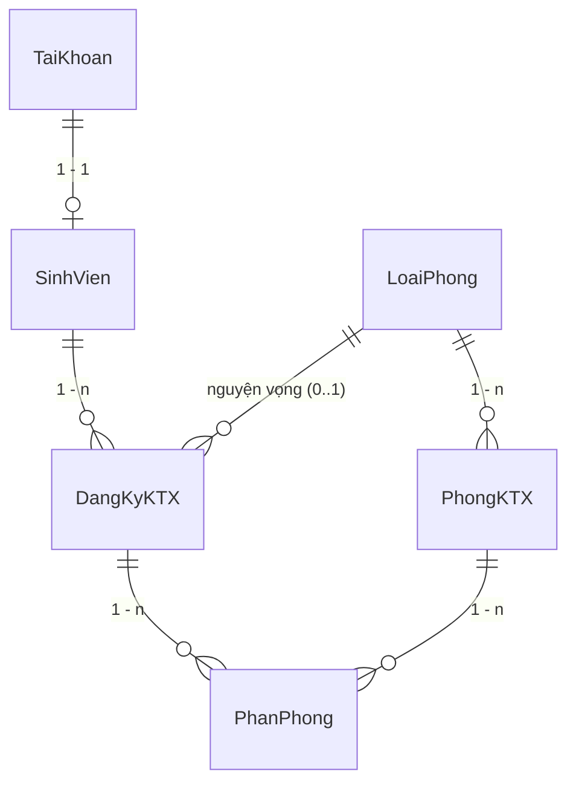

# Thiết kế cơ sở dữ liệu

## 1. Sơ đồ quan hệ (ERD)

## 2. Các bảng
### TaiKhoan
| Cột | Kiểu | Ràng buộc |
|---|---|---|
| MaTaiKhoan | int | PK, identity |
| TenDangNhap | nvarchar(50) | bắt buộc, **UNIQUE** |
| MatKhau | nvarchar(255) | bắt buộc, lưu **mã băm** (PasswordHasher) |
| HoTen | nvarchar(100) | bắt buộc |
| Email | nvarchar(100) | bắt buộc, đúng định dạng |
| VaiTro | nvarchar(20) | `Admin` / `Sinh viên` (do hệ thống đặt) |
| TrangThai | nvarchar(20) | `Hoạt động` / `Khóa` |

### LoaiPhong
| Cột | Kiểu | Ràng buộc |
|---|---|---|
| MaLoaiPhong | int | PK |
| TenLoaiPhong | nvarchar(100) | bắt buộc, **UNIQUE** |
| SoNguoiToiDa | int | > 0 (sức chứa) |
| DonGiaThang | decimal(18,0) | > 0 |
| MoTa | nvarchar(500) | null được |
| TrangThai | nvarchar(20) | `Hoạt động` / `Ngừng sử dụng` |

### PhongKTX
| Cột | Kiểu | Ràng buộc |
|---|---|---|
| MaPhong | int | PK |
| TenPhong | nvarchar(50) | bắt buộc, **UNIQUE** |
| MaLoaiPhong | int | FK → LoaiPhong (Restrict) |
| ToaNha | nvarchar(50) | bắt buộc |
| Tang | int | 1..30 |
| GioiTinhPhong | nvarchar(10) | `Nam` / `Nữ` |
| TrangThai | nvarchar(20) | `Đang sử dụng` / `Tạm ngừng` |
| MoTa | nvarchar(500) | null được |

> **Không có cột SoChoCon.** Số chỗ còn = `LoaiPhong.SoNguoiToiDa` − số `PhanPhong` có `TrangThai = 'Đang ở'` (tính bằng LINQ).

### SinhVien
| Cột | Kiểu | Ràng buộc |
|---|---|---|
| MaSinhVien | nvarchar(20) | **PK** (nhập tay, không trùng) |
| MaTaiKhoan | int | FK → TaiKhoan, **UNIQUE** (quan hệ 1-1) |
| HoTen, NgaySinh, GioiTinh, Lop, Khoa | … | HoTen/NgaySinh/GioiTinh bắt buộc |
| SoDienThoai | nvarchar | `^0\d{9}$` |
| Email | nvarchar(100) | đúng định dạng |
| DiaChi | nvarchar(200) | null được |
| TrangThai | nvarchar(20) | `Đang hoạt động` / `Ngừng hoạt động` |

### DangKyKTX
| Cột | Kiểu | Ràng buộc |
|---|---|---|
| MaDangKy | int | PK |
| MaSinhVien | nvarchar(20) | FK → SinhVien (Restrict) |
| NgayDangKy | datetime2 | do hệ thống đặt |
| NgayBatDau / NgayKetThucDuKien | datetime2 | kết thúc > bắt đầu |
| NguyenVongLoaiPhong | int null | FK → LoaiPhong (chỉ tham khảo) |
| GhiChu | nvarchar(500) | null được |
| TrangThai | nvarchar(20) | `Chờ duyệt` → `Đã phân phòng` → `Đã trả phòng`; hoặc `Đã hủy` |

Chỉ mục duy nhất có điều kiện: `MaSinhVien` **UNIQUE WHERE TrangThai ∉ {Đã hủy, Đã trả phòng}` → mỗi sinh viên chỉ có 1 đăng ký đang hiệu lực (Chờ duyệt hoặc Đã phân phòng).

### PhanPhong (lịch sử ở thực tế)
| Cột | Kiểu | Ràng buộc |
|---|---|---|
| MaPhanPhong | int | PK |
| MaDangKy | int | FK → DangKyKTX (Restrict) |
| MaPhong | int | FK → PhongKTX (Restrict) |
| NgayVao | datetime2 | bắt buộc |
| NgayRa | datetime2 null | null khi đang ở |
| TrangThai | nvarchar(20) | `Đang ở` / `Đã chuyển` / `Đã trả phòng` |

Chỉ mục duy nhất có điều kiện: `MaDangKy` **UNIQUE WHERE TrangThai = 'Đang ở'** → một sinh viên không thể có hai phòng "Đang ở" cùng lúc, kể cả khi hai người dùng thao tác đồng thời.

## 3. Nguyên tắc thiết kế
- Mọi khóa ngoại dùng `OnDelete(Restrict)`: không xóa dây chuyền, không làm mất lịch sử.
- Tập giá trị trạng thái nằm ở `Constants/TrangThai.cs`, dùng thống nhất toàn Project.
- Không đặt `MaPhong` trong `SinhVien`; quan hệ phòng–sinh viên chỉ đi qua `DangKyKTX` → `PhanPhong`.
- Chuyển phòng: bản ghi cũ → `Đã chuyển` + `NgayRa`, tạo bản ghi mới `Đang ở`. Trả phòng: `PhanPhong` và `DangKyKTX` → `Đã trả phòng`. Không xóa bản ghi `PhanPhong` đã phát sinh.
